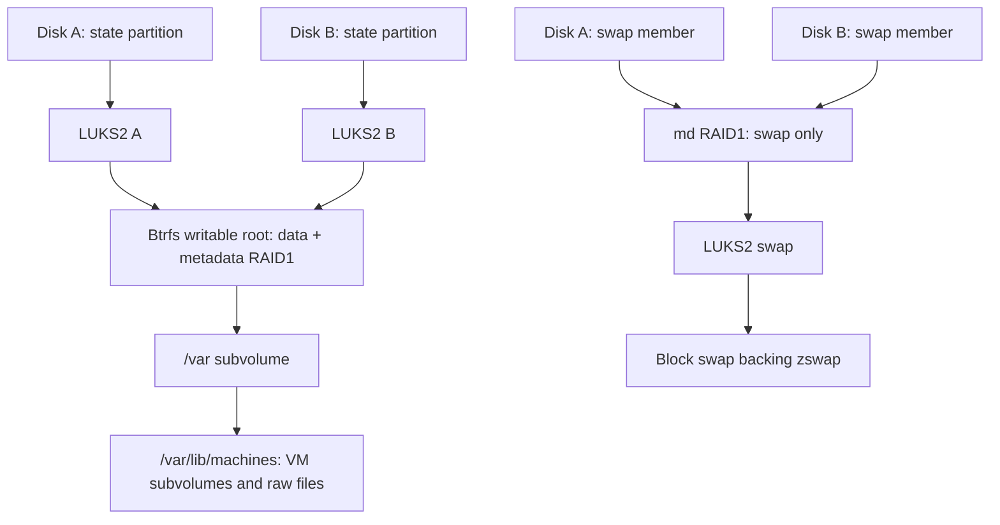

# ParticleVE implementation plan

Date: 2026-11-06

Status: Uncommissioned candidate implementation and disposable acceptance in progress; see [validation status](Documentation/Status.md). The owner selected delivery without physical-host commissioning. Automatic OS timers remain disabled.

Build a reusable, minimal, headless ParticleOS hypervisor that runs on machines meeting the platform requirements below. Use Fedora 45, upstream systemd stable packages from OBS, and systemd-vmspawn with QEMU/KVM. Follow ParticleOS's EROFS/verity and encrypted Btrfs storage model, extending it for an independently bootable two-disk pair. Hardware identity, disk capacity, and device naming are installation inputs rather than properties of the image.

This plan consolidates the latest host-platform decisions in [Design Hypervisor Server](https://chatgpt.com/c/6aec45c5-0740-83ed-a93a-0cbe84de07e4): the systemd virtualization route, no web UI, and storage close to upstream. Workloads, their deployment and management, Ansible/OpenTofu configuration, and backups are entirely out of scope. Boot fallback, disk replacement, encryption recovery, and the host's maintenance integration remain in scope. Disposable VMs are used only to validate host capabilities and that integration.

## 1. Requirements and boundaries

| Area | Required behavior |
| --- | --- |
| Hardware | Any machine satisfying the CPU, boot, TPM, storage, memory, and device-support requirements below. |
| Base | Fedora 45, explicitly selected instead of inheriting Rawhide. |
| Upstream relationship | A small ParticleOS profile using mkosi, EROFS/verity `/usr`, encrypted Btrfs writable root, UKIs, systemd-boot, and sysupdate. |
| systemd | The upstream `system:systemd:stable` OBS package family, including the initrd and build tools where applicable. |
| Virtualization | systemd-vmspawn, the upstream `systemd-vmspawn@.service` template, systemd-machined, machinectl, and QEMU/KVM. Pin exact package versions in each build. |
| Storage | Independent ESPs and verified OS slots on both disks; encrypted native Btrfs RAID1 for writable root and VM files; separate encrypted mirrored block swap. |
| Boot security | Secure Boot, signed UKIs, dm-verity, and TPM2 unlock without a PIN for normal unattended boots. |
| Memory | zswap backed by encrypted mirrored block swap; disable the inherited zram defaults. |
| Networking | systemd-networkd, resolved, and nftables; management restricted to the management network or VPN. |
| Builds | OBS automatically rebuilds when relevant Fedora/systemd dependencies or project sources change. |
| Publication | One signed ParticleVE feed, with artifacts for each supported target architecture; compatible machines share the same image. |
| OS maintenance | Enable automatic preparation only after commissioning. Start maintenance at 04:30 Europe/Berlin only for an eligible OS update; request reboot only after VMs have exited gracefully. |
| Firmware | Working fwupd, including its EFI helper and dependencies. Metadata refresh may be automatic; installation and its reboot are manual. |

Each installation is an independent host. Administration uses SSH, systemctl, machinectl, and the journal. Keep Incus, web management interfaces, libvirt, a desktop environment, host application containers, clustering, and a separate deployment/promotion service outside the implementation. A second physical test server or permanently running external CI runner is not required. OBS performs build checks; commissioning uses the target machine, with disposable local VMs where practical.

### 1.1 Platform requirements

| Capability | Requirement |
| --- | --- |
| CPU and architecture | A target architecture with a validated ParticleVE build of the selected Fedora, ParticleOS/systemd, and QEMU stack. Hardware virtualization must be enabled and usable through KVM. Publish the supported architectures and CPU baseline with each release. |
| Firmware boot | UEFI capable of booting the signed systemd-boot/UKI chain, enrolling the intended Secure Boot trust, and booting either selected disk independently. |
| TPM | Working TPM 2.0 supported by the selected kernel/systemd stack, with enrollment and recovery access available. |
| Storage | At least two independent, firmware-bootable block devices supported by Linux. Select two as the boot/mirror pair. Each must fit the calculated layout; neither NVMe nor a particular capacity is required. |
| Memory | Enough physical RAM for the measured host baseline, maintenance operations, and virtualization overhead. Publish a measured minimum before the first release; swap is not counted toward that minimum. |
| Devices | Storage controllers and management NICs supported by the image's kernel drivers and firmware. |
| Recovery access | A working local, serial, or remote console through which the owner can use recovery credentials and select a boot path. A particular display connector or management controller is not required. |
| Firmware maintenance | fwupd must run correctly and support the update transports used by supported devices. Vendor availability of firmware updates is recorded per device; unsupported devices are reported explicitly. |

Check the selected release's [systemd-vmspawn requirements and interfaces](https://www.freedesktop.org/software/systemd/man/latest/systemd-vmspawn.html), including QEMU, KVM, and guest firmware support on each target architecture. IOMMU setup for device assignment and workload sizing are outside the baseline host requirements.

Implement a capability preflight that reports unmet requirements before installation changes any disk. Publish measured resource minima and validated architecture/driver coverage; passing on one machine is not evidence that every firmware or controller implementation behaves identically.

### 1.2 Portability and installation configuration

- Build a generic image for each supported architecture and CPU baseline. For an x86-64 target, include support for both Intel and AMD virtualization and their applicable microcode. Do not use build-host CPU optimization such as `-march=native`.
- Keep the storage, network, TPM, and firmware drivers needed for the supported hardware range. Do not prune the kernel/initrd or firmware collection to the devices present on the OBS worker or the first installation.
- Resolve boot disks, NICs, and ESPs from explicit installation configuration and stable identities. Avoid fixed PCI addresses, interface names, disk enumeration, or DMI/model checks in the core logic.
- Make partition sizes, host memory/swap settings, network configuration, and console selection configurable, with validated defaults and minimums.
- Let upstream kernel/fwupd hardware detection and quirk databases select device behavior. Isolate any unavoidable downstream quirk, document its detection condition, and test the generic path independently.
- Keep the selected disk pair, host identity, credentials, TPM enrollment, and network settings in per-installation configuration. OS updates must preserve these values and use the shared image/feed.

## 2. Architecture and ownership

| Layer | Owner and responsibilities |
| --- | --- |
| Build configuration | ParticleVE profile: selected upstream revisions, package list, image defaults, security configuration, and integration units. |
| Builds and signing | OBS: dependency resolution, RPM/image builds, signing integration, manifests, and publication. Private signing material stays off deployed hosts and out of source files. |
| Boot and OS | ParticleOS/systemd: UKIs, verified `/usr`, image transfer, boot counting, and boot assessment. |
| Two-disk integration | Small coordinator: explicit disk targets, complete release checks, ESP artifacts, maintenance exclusion, and accepted/rejected release state. |
| Writable storage | Host configuration: per-device LUKS2 unlock, native Btrfs RAID1, persistent subvolumes, separate encrypted swap, and capacity/health reporting. |
| Network | networkd owns the host's physical NICs, management addressing, VLAN interfaces, and bridges. |
| Virtualization runtime | Packaged systemd-vmspawn template, machined/machinectl, QEMU, guest firmware, and integration with host maintenance. |
| External VM configuration | Outside this project: VM definitions, images, resource limits, network attachments, startup policy, and ordinary lifecycle management. |

Reuse upstream services and interfaces. Add only the host integration needed for two-disk installation, coordinated OS updates, and checking that VMs have stopped before an automatic reboot. Do not introduce a VM inventory service or a replacement management API.

## 3. Storage and boot design

### 3.1 Preserve the final upstream-oriented layout

Each disk in the selected boot pair has an independent FAT ESP and equivalent ParticleOS EROFS `/usr`, verity, and verity-signature update slots. Writable storage uses native Btrfs RAID1 across individually encrypted state partitions. Additional devices remain untouched unless explicitly selected for a separate storage configuration.

| Logical area | Boot disk A | Boot disk B |
| --- | --- | --- |
| EFI boot | Independent ESP with signed systemd-boot and UKIs | Independent ESP with corresponding artifacts |
| OS slot A | `/usr` image and matching verification artifacts | Matching complete release |
| OS slot B | Inactive/update or fallback release | Matching complete release |
| Writable root, `/var`, and VM files | LUKS2 partition containing one Btrfs device | Independently encrypted second Btrfs device |
| Block swap | Member of a separate encrypted swap mirror | Other member |

The acceptance promise is that the host can boot from either disk with the other absent, and persistent host/guest data remains available from the surviving mirror member. **Continuous operation after loss of the disk serving the active `/usr` is not guaranteed; recovery may require a reboot.** File-backed `/usr` on a RAID filesystem is not the initial design.

Two OS slots retain the running release and one other release. Preparing an update can replace the older inactive release. Do not promise simultaneous retention of current, previous, and next releases without adding another complete slot.

### 3.2 Follow upstream writable storage with native Btrfs mirroring

Use one Btrfs filesystem with **RAID1 for both data and metadata**. Keep `/var` as a subvolume and store raw VM image files under `/var/lib/machines`. During normal boot, decrypt both state partitions before Btrfs discovers the filesystem. Btrfs manages the mirror directly over these decrypted devices.



Follow the [upstream root partition definition](https://github.com/systemd/particleos/blob/main/mkosi.extra/usr/lib/repart.d/40-root.conf) for encrypted Btrfs and `/var`, with the following explicit changes:

- Create the native two-device mirror and validate its data and metadata profiles.
- Omit the separate `/home` partition. Administrator home directories live on the encrypted writable root.
- Set **`FactoryReset=no`** for the writable root on both disks. Remove reset paths that would format it. A subvolume is not protection against formatting its containing filesystem.
- Keep swap on separate encrypted block storage. Preserve the mirrored-swap requirement using a small md RAID1 device beneath LUKS2, limited to swap; validate this additional integration during the storage prototype. Do not use a swapfile on the mirrored Btrfs filesystem.

The host storage contract is one subvolume per VM, containing its raw image and persistent auxiliary state. External VM provisioning creates these subvolumes and selects image paths; the host supplies the filesystem, supported path/permission conventions, and runtime capability. Persistent EFI variables and any virtual TPM state must survive host updates and remain paired with the corresponding VM.

Follow the upstream raw-image creation/import behavior for NOCOW files and verify the resulting attributes during commissioning. Apply that policy only to raw VM disk files at creation time. Keep ordinary host files and EFI/vTPM state under normal CoW; do not set `nodatacow` globally or blanket-disable CoW on `/var/lib/machines`. NOCOW file contents lack Btrfs data checksums and compression, so RAID1 does not provide checksum-based detection and repair of silent corruption in those contents. Metadata retains its checksums. Document this tradeoff and the selected external image-creation convention; do not retrofit attributes onto existing VM disks. See [Btrfs CoW and checksum behavior](https://btrfs.readthedocs.io/en/latest/btrfs-man5.html).

Use persistent device identities throughout. Record partition, LUKS, Btrfs filesystem/device, and swap-array identities in the installation manifest. Resolve logical disk roles from those identities on each boot; do not depend on kernel device enumeration remaining constant.

Calculate the layout from artifact sizes and explicit installation settings:

- Size each ESP for retained signed boot artifacts, firmware staging, and growth margin. Check firmware/device-specific staging requirements during preflight.
- Two complete OS slots per disk, each sized from the built `/usr` image with growth margin and matching verity partitions.
- Size the shared Btrfs filesystem for host state, VM files, bounded logs/caches, update working space, and operational headroom. Subvolumes do not reserve capacity or isolate filesystem exhaustion.
- Make mirrored encrypted swap capacity configurable and choose a default from host memory-pressure measurements.
- Allocate the configured remaining mirrored capacity to Btrfs, retaining enough free space for both data and metadata allocation, replacement, and recovery operations.
- Base mirrored allocations on the smaller selected device after overhead. Support unequal drive capacities without silently allocating unmirrored data.
- Validate logical/physical sector sizes, alignment, and replacement-device capacity. Reject a layout that cannot fit before making changes.

Do not enable discard through encryption automatically; choose and document that policy during storage commissioning. Monitor Btrfs data/metadata allocation and free space, device errors, scrub results, mirror profiles, swap-array health, and physical device health. Bound host logs/caches and define shared-space thresholds before enabling automatic maintenance. Scrub cannot checksum-verify NOCOW file contents.

### 3.3 Required boot integration

- Include Btrfs, device-mapper/LUKS, TPM, storage-controller support, and mdraid for the separate swap mirror in the initrd.
- Unlock both state partitions independently and discover their shared Btrfs filesystem before mounting the writable root. Validate TPM enrollment and owner recovery for every encrypted device.
- Implement an explicit, bounded degraded-boot path for an absent disk. Btrfs does not mount degraded by default; validate the missing-device timeout, correct surviving-device selection, and permitted read/write operation without enabling degraded mounts indiscriminately.
- Preserve ParticleOS's verified `/usr` discovery and the signed kernel/userspace association. Verify which physical OS slot was selected from each ESP.
- Ensure the writable root, `/var`, and VM image paths are available before externally configured VM units start.
- Give each disk unique disk/ESP identities, its own firmware boot entry, and a usable UEFI fallback boot path. Validate the OS-partition identifiers required by upstream discovery separately.
- Replicate intended boot artifacts without overwriting ESP-local boot counters or pending fwupd files.
- Test shutdown ordering so VM processes exit before their storage disappears.
- Provide a disk-replacement procedure that recreates partitions and encryption, replaces the missing Btrfs device, resynchronizes swap, installs matching OS artifacts, and establishes an independently bootable ESP.
- After degraded writes or replacement, inspect allocated block-group profiles and restore data and metadata RAID1 as needed. Do not declare the mirror healthy merely because two devices are present; see [Btrfs degraded mount behavior](https://btrfs.readthedocs.io/en/latest/btrfs-man5.html).

The dual-disk installer and updater are custom integration work. Stock single-disk discovery and transfer settings must not be assumed to coordinate the selected boot pair.

## 4. Image, package, and security policy

### 4.1 Keep a small downstream profile

Start from ParticleOS's headless mkosi/OBS approach. Pin the ParticleOS and mkosi revisions as a compatible pair with the chosen stable systemd packages. When upstream ParticleOS requires unreleased systemd functionality, hold the last compatible ParticleOS revision while continuing applicable Fedora/package updates. Upstream explicitly describes its development status and systemd dependency in the [ParticleOS README](https://github.com/systemd/particleos).

Record the exact source revisions, RPM versions and origins, image version, artifact hashes, and signing identities for every published build. Verify the systemd package family in the build environment, initrd, and installed `/usr`; a profile name alone is insufficient evidence.

### 4.2 Explicit runtime capabilities

| Capability | Include and verify |
| --- | --- |
| OS lifecycle | systemd-boot, UKI/verity support, sysupdate, cryptsetup, TPM tooling, and selected recovery utilities. |
| Virtualization | The selected systemd package family's `systemd-container` components: vmspawn, its service template, machined, and machinectl. Architecture-appropriate headless QEMU/KVM, `qemu-img`, and guest UEFI firmware; `swtpm` when virtual TPM support is selected. Verify actual package contents. |
| Storage | btrfs-progs, cryptsetup, mdadm for mirrored swap, required filesystem utilities, and diagnostics covering supported disk/controller types. |
| Network | networkd, resolved, nftables, CA certificates, time synchronization, and basic IP/DNS diagnostics. |
| Firmware | fwupd, fwupd-efi, UDisks2, required plugin/quirk/trust data, and writable firmware state/cache. |
| Hardware | CPU microcode, device firmware, and kernel modules for the supported architecture and hardware range, including in the UKI where needed. |
| Administration | SSH, existing ParticleOS account/PAM/Polkit integration, one shell, one editor, and systemd/journal tools. |
| Confinement | SELinux policy, labels, enforcing operation, and useful audit logging. |
| Scheduling | Timezone data for the explicit Europe/Berlin maintenance schedule. |

Resolve required weak dependencies explicitly in the image recipe. Use the guest firmware package appropriate to the target architecture, such as OVMF on x86-64. Keep build tools, compilers, unnecessary debugging packages, desktop services, NetworkManager, PackageKit, and zram defaults out of the runtime image when dependency resolution permits. Preserve upstream package dependencies and ParticleOS's authentication stack, including Python if required; do not create a custom stripped systemd package family.

Review the final package manifest and enabled services after each reduction. Remove inherited settings such as `audit=0` if they prevent the required audit behavior. Validate vmspawn/QEMU process domains, filesystem labels, service sandboxing, and device/network access under SELinux enforcing. Do not assume that using QEMU automatically supplies libvirt-style per-VM isolation. Resolve policy gaps narrowly and test isolation with disposable VMs; broad permissive policy is not an acceptance path.

### 4.3 Signing, trust, and persistent state

- Sign systemd-boot and UKIs with the intended trusted identity; authenticate the userspace and update artifacts through the configured verity/update trust chains.
- Configure every OS transfer to the ParticleVE feed. Audit inherited trust and feed settings so an upstream image cannot silently replace the customized host.
- Keep only public verification material on the host. Keep signing keys and machine secrets out of published OBS sources and images.
- Put reproducible defaults in the image using ParticleOS's factory configuration model. Keep machine identity, externally supplied VM configuration, VM disks/EFI/vTPM state, firmware history, and mutable credentials on encrypted writable storage.
- Inspect rescue, debug, and factory-reset profiles. Verify `FactoryReset=no` for the shared writable root and ensure no reset or automatic root-rollback path can erase or rewind VM state. Do not give a recovery profile normal TPM unlock authority automatically.
- Retain an owner-operated recovery environment and independently accessible LUKS recovery credentials.

For TPM enrollment, validate a policy that permits routine signed OS updates and booting from either disk. The initial design discussed PCR 7 plus signed PCR 11 authorization; later firmware discussion introduced pcrlock. Select and document the actual policy during the security prototype rather than combining these mechanisms without validation. Only rely on fwupd's pcrlock integration if enrollment and boot services actually use that supported policy.

## 5. Host networking and virtualization runtime

### 5.1 Host network integration

networkd owns physical interfaces, management addressing, VLAN interfaces, and host bridges. Each interface or bridge must have one configuration owner. Configure the host's attachment to the existing network using the supplied topology.

- Configure a stable host management address, gateway, DNS, and time synchronization.
- Restrict SSH to approved management-network or VPN sources, with authenticated access. Use local systemd/machined interfaces for runtime administration.
- Provide the required host bridges and VLAN interfaces without defining guest attachments or service-specific network policy.
- Define IPv4 and IPv6 host firewall rules and verify that other interfaces do not expose administration listeners.

Record actual NIC identities, VLAN IDs, host addresses, gateways, and DNS before producing configuration. External routing, ingress services, tunnel deployment, and workload network design are outside this host plan. Document that host input filtering alone does not isolate traffic between guests sharing a bridge.

### 5.2 systemd-vmspawn runtime and host memory

- Include vmspawn, `systemd-vmspawn@.service`, machined, and machinectl from the same stable systemd build as the rest of the host. Use the packaged template as the runtime integration point.
- Expose the Btrfs storage and raw-image path conventions from section 3. External configuration supplies per-VM image paths, unit settings, and startup policy through supported upstream interfaces; this project does not generate those definitions.
- Require usable KVM acceleration. Verify QEMU integration, guest UEFI, machine registration, console access, raw disk I/O, and host bridge/TAP support with disposable test VMs.
- Verify persistent EFI variable storage and, when included, virtual TPM state. Test permissions and restart behavior without resetting either state store.
- Ensure OS installation, update, and recovery procedures preserve externally managed VM configuration and persistent files.
- Establish a measured host memory budget that includes QEMU overhead and zswap. Per-workload resource allocations belong outside this plan.

Enable `zswap.enabled=1` through the signed UKI command line and initially retain the kernel's compressor/pool defaults. Verify that encrypted block swap is active and inherited zram swap is absent. Report sustained swap I/O as host capacity pressure.

### 5.3 Integration with host startup and shutdown

Use the upstream vmspawn service template and machined registration to identify running VMs and their owning units. Validate mount dependencies and shutdown ordering before enabling unattended maintenance. External configuration owns which VMs start at boot; the host must preserve permanent enablement, restart policy, and per-VM definitions.

For automatic OS maintenance, request graceful poweroff and wait for the actual VM processes to exit **before requesting host reboot**. In the supported systemd interface, [`machinectl poweroff`](https://www.freedesktop.org/software/systemd/man/261/machinectl.html) sends a vmspawn VM an ACPI powerdown request through QMP. Verify this behavior in the pinned build; successful request submission is not proof that the guest stopped. A normal service stop can eventually terminate QEMU, so it is not a substitute for this check.

If a VM refuses to shut down within the maintenance deadline, defer reboot, restore only the VMs stopped by that maintenance attempt, and report the failure. A failing `ExecStop=` after the host reboot transaction has begun cannot cancel that reboot. Section 7.2 defines the full sequence, including restart races and aborted maintenance. General workload lifecycle management remains external.

## 6. OBS builds and publication

1. Create the project/package definitions for the headless image and small host integration package. Resolve the stable systemd/container family, architecture-appropriate QEMU/firmware, and storage tools. Define supported architecture targets and generic CPU baselines; keep per-machine and per-VM configuration outside these recipes.
2. Select Fedora 45 base/updates and prioritize the intended `system:systemd:stable` source for the complete systemd family. Verify resolved package origins.
3. Generate OBS's extracted mkosi dependency recipe from the real configuration, covering runtime, initrd, and build dependencies. Follow the [OBS mkosi recipe requirements](https://openbuildservice.org/help/manuals/obs-user-guide/cha-obs-package-formats).
4. Retain `rebuild="transitive"` and `block="all"` so dependency changes trigger rebuilds and unfinished dependencies block the image build. These are documented in [OBS scheduling](https://openbuildservice.org/help/manuals/obs-user-guide/cha-obs-build-scheduling-and-dispatching).
5. Wire Git changes to OBS source-service refresh, including fetching the changed source revision. Package dependency rebuilds alone do not update a pinned source snapshot.
6. Give package-only rebuilds a new monotonically advancing image version, preserving OBS build-counter versioning. Record versions even when the ParticleVE source commit is unchanged.
7. Run build-time checks for package contents, service configuration, required boot/firmware artifacts, signatures, and matching release identifiers. Verify that artifact architecture, CPU baseline, and kernel/initrd driver coverage match the declared compatibility requirements.
8. Publish a complete signed release to the single ParticleVE feed. Advance discoverable metadata only when all required artifacts are available. Failed builds leave the existing usable feed intact.
9. Report failed builds and stale upstream imports. Automatic rebuilds follow OBS metadata refresh and scheduling delays; they are not instantaneous for every upstream package publication.

Signing coverage must be verified separately for RPMs, release metadata, UKIs, verity artifacts, systemd-boot, and fwupd's EFI helper. Do not assume an OBS package signature establishes every required boot trust relationship.

## 7. Two-disk OS update workflow

Implement one serialized coordinator around the upstream tools. Store durable transaction state under a proposed `/var/lib/particleve/` directory, including release identity, per-disk completion, selected boot entries, successful/rejected releases, manual-maintenance inhibition, and the bounded VM shutdown attempt. Reconcile that state against actual disks and runtime state after interruption.

```text
available -> preparing -> ready on both disks -> VMs stopped -> booting -> accepted
                 |                 |                  |            |
              deferred          deferred           deferred     rejected
```

### 7.1 Prepare a release

1. Acquire the maintenance lock and check manual firmware/storage maintenance state.
2. Select one explicit release version from the authenticated feed and retain that version throughout the transaction.
3. Check signatures, required artifacts, disk identity/health, free space, and the persistent-state compatibility policy.
4. Prepare the inactive `/usr` and verification slots on both selected boot disks, preserving the running release. Use explicit targets from the installation manifest; `Path=auto` alone does not update both disks.
5. Verify each complete installed set before exposing its boot entry. Deploy matching UKIs and any required signed bootloader updates without disturbing fwupd staging or ESP-local state.
6. Mark the release ready only when both boot paths contain the same complete release and a usable fallback remains.
7. Keep cleanup from removing any image or artifact referenced by a running or retained boot entry.

Interruptions must leave at least one coherent boot/recovery path. Multi-resource, two-disk installation is not one atomic write. No visible boot entry may point at an incomplete OS set. Validate selection behavior if an unscheduled restart happens during preparation as well as the scheduled activation path.

Defer automatic activation while a disk is missing, storage redundancy is degraded or being restored, or either ESP is incomplete. Document a deliberate manual path for necessary security updates during prolonged degraded operation.

### 7.2 Conditional 04:30 maintenance and reboot

Use a dedicated host maintenance service as the only automatic reboot entry point. Reuse upstream sysupdate's pending-version and conditional reboot interfaces behind the coordinator; see [systemd-sysupdate](https://www.freedesktop.org/software/systemd/man/latest/systemd-sysupdate.html). Do not use an immediate `--reboot` option during ordinary preparation or rely on a shutdown-time failure to prevent reboot.

Planned timer:

```ini
# /usr/lib/systemd/system/particleve-maintenance.timer
[Unit]
Description=Activate a ready ParticleVE OS update after graceful VM shutdown

[Timer]
OnCalendar=*-*-* 04:30:00 Europe/Berlin
AccuracySec=1s
RandomizedDelaySec=0
Persistent=false
Unit=particleve-maintenance.service

[Install]
WantedBy=timers.target
```

The service performs this sequence while the host is still in normal operation:

1. Acquire the shared maintenance lock. Check the schedule and confirm one eligible pending OS version is complete on both disks, not rejected, and has a usable fallback. Check storage health, headroom, manual maintenance, and staged firmware. Exit without touching VMs when any check fails or no update is ready.
2. Temporarily inhibit new VM starts and automatic restarts through a validated host integration, then record the currently running VM/unit set. Reconcile machined registrations and unit/process state; if that inventory is incomplete or ambiguous, use the abort path below.
3. Request graceful poweroff for that set and wait for actual process exit within a bounded deadline. Do not kill a refusing VM to make the automatic reboot proceed. Track which VMs this attempt actually stopped, including late exits.
4. If shutdown or any check fails after applying the temporary restriction, cancel activation, release that restriction in a controlled order, and restart only the VMs stopped by this attempt. Leave previously stopped VMs stopped and still-running VMs alone. Report failed restoration explicitly; reconcile interrupted attempts instead of silently leaving VMs down.
5. Recheck the pending version, both boot paths, maintenance exclusions, and absence of running/restarting VMs. Keep the lock and temporary start restriction effective through the host reboot request. Only then invoke the guarded conditional reboot path. If no reboot is queued or the request fails, run the same restoration path.
6. After a successful reboot, let externally configured startup policy govern VM startup. Report the maintenance outcome and reconcile the transaction record; do not invent automatic last-running-state restoration or alter permanent unit enablement.

The temporary start/restart restriction and recovery from an interrupted shutdown attempt must be proven with the selected template and external configuration contract. Keep automatic activation disabled until that integration handles restart policies, concurrent start requests, and late guest exits correctly.

Disable the independent stock sysupdate reboot timer and route automatic OS preparation through the coordinator as well. No automatic service may bypass the two-disk and VM-shutdown checks.

04:30 is the start of maintenance; reboot follows only after the bounded graceful shutdown completes. With no update, failed preparation, or a failed check, leave the host running and record the reason. A missed window must not cause a daytime catch-up reboot. Validate timer and service behavior after downtime, delayed activation, and both daylight-saving transitions.

### 7.3 Assess and recover

Add bounded health checks before `boot-complete.target` and bless the boot only after required storage, management networking, KVM, vmspawn/machined runtime availability, and SELinux enforcement succeed. Validate the host's virtual disk/network paths with a disposable VM during commissioning. Use the [systemd boot assessment integration](https://systemd.io/AUTOMATIC_BOOT_ASSESSMENT/) and a tested watchdog/timeout path so failed boots can actually reach another attempt.

Reconcile accepted/rejected versions across both ESPs without resetting exhausted counters. After fallback, quarantine the failed release so the next 04:30 window does not retry it indefinitely. Keep an unavailable external website or an application-level fault from causing a host rollback loop.

Boot fallback selects an older verified OS image; it does not rewind the writable Btrfs root or VM files. Validate that the retained kernel/systemd/QEMU/firmware stack can use the current Btrfs features, external unit definitions, and persistent EFI/vTPM state. Keep incompatible filesystem feature changes or persistent-state transitions out of unattended activation. Such transitions require a separate explicit decision and validation; this plan does not add migration machinery. Never roll back the shared writable root as a side effect of OS fallback.

## 8. Manual firmware maintenance

Keep fwupd, fwupd-efi, UDisks2, vendor trust data, and upstream hardware quirks in the minimal image. Discover devices and supported update transports on each installation. Let fwupd select the applicable device behavior; do not force one manufacturer's capsule route or a fixed ESP path across machines. Record which devices support updates, which need another vendor procedure, and which have no available update.

Explicitly sign/package the EFI updater so it is trusted by the enrolled Secure Boot chain. Signing the normal UKI does not establish trust for that separate executable; see [fwupd's UEFI helper requirements](https://github.com/fwupd/fwupd/blob/main/plugins/uefi-capsule/README.md). Verify discovery and writable access to the selected ESP from either boot disk.

Automatic jobs may refresh metadata and report available updates. **Do not schedule firmware installation, capsule staging, `fwupdmgr update`, or `fwupdmgr install`.** Updating the fwupd package inside an OS image remains part of ordinary OS updates.

Manual procedure to implement and document:

1. Enter persistent maintenance mode that inhibits automatic OS installation and reboot, including across a restart.
2. Inspect devices, available updates, power requirements, Secure Boot trust, TPM policy, and recovery access.
3. Use the currently proven OS for firmware maintenance; defer first boot of a new OS release.
4. Manually apply or stage selected updates. Preserve the helper files and EFI `BootNext` state on the correct ESP.
5. Perform the supervised reboot or full power cycle required by the device. Handle multi-cycle updates explicitly.
6. Verify actual device versions and fwupd results/history, then verify Secure Boot, TPM unlock, networking, Btrfs/swap health, and the vmspawn/QEMU runtime.
7. Clear maintenance mode only after results and any remaining staged updates have been reviewed.

Treat Secure Boot `db`/`dbx` updates as manual firmware/security maintenance too. Document the enrolled authorization keys and measurement effects. Firmware rollback is not provided by selecting an older ParticleOS image.

## 9. Implementation milestones

The implementation and measured evidence are tracked below and in Documentation/Status.md. A checked implementation item does not close a milestone whose full exit criteria remain unvalidated. M6 physical commissioning and automatic enablement are excluded from the selected candidate delivery.

### M1 — Inventory and compatible build baseline

- [ ] Define supported architectures, CPU baselines, driver coverage, and the capability preflight; measure host RAM and storage minima.
- [ ] Record each test installation's hardware capabilities, stable disk/NIC identities, firmware support, recovery access, and network configuration.
- [x] Pin compatible ParticleOS/mkosi inputs, Fedora 45, the stable systemd package family, and current compatible QEMU/guest firmware packages for each supported architecture.
- [x] Establish the headless profile, OBS definitions, dependency recipe, source triggers, signing coverage, and single update feed.
- [x] Produce the package manifest and a bootable baseline image with automation timers disabled.

Exit: the built image contains the intended package versions and required runtime/firmware components, with no accidental desktop profile or upstream update-feed inheritance.

### M2 — Dual-disk installation and verified boot

- [x] Implement configurable layout sizing, per-device LUKS2, native Btrfs data/metadata RAID1, `/var`, separate encrypted mirrored swap, and the installation manifest.
- [x] Omit the separate `/home` partition; disable destructive root reset and automatic writable-root rollback paths.
- [x] Implement installation and independent ESP setup using explicit disk identities.
- [x] Enroll and test Secure Boot, verity verification, TPM unlock, and owner recovery.
- [x] Validate generic initrd discovery, bounded degraded boot, degraded writes, disk replacement, and restoration of RAID1 profiles and both boot paths.

Exit: either selected boot disk alone boots the intended verified OS and makes encrypted host/guest storage available. The active-`/usr` disk-loss limitation is documented and tested.

### M3 — Minimal usable virtualization host

- [x] Configure management networking, bridges/VLANs, nftables, and SSH.
- [x] Verify the packaged vmspawn template, machined/machinectl integration, KVM, and architecture-appropriate QEMU/firmware components.
- [x] Document the external VM storage/unit interface, including per-VM subvolumes, raw file attributes, and persistent EFI/vTPM state.
- [ ] Verify the runtime with a disposable test VM: registration, console, disk/network I/O, and persistent firmware/optional TPM state.
- [ ] Verify SELinux confinement, microcode/device firmware, zswap, encrypted swap, and host memory headroom.
- [ ] Verify storage dependencies and graceful poweroff with disposable VMs while preserving externally defined startup policies.
- [x] Validate shared Btrfs capacity reporting, bounded host logs/caches, and the documented NOCOW tradeoff.

Exit: host administration, networking, storage, and the virtualization runtime work with the intended package/service footprint.

### M4 — Coordinated OS update and fallback

- [x] Implement transaction state, explicit per-disk transfers, ESP handling, locking, and rejected-release tracking.
- [x] Add the conditional maintenance timer, pre-reboot VM shutdown check, temporary start/restart inhibition, health assessment, and recovery timeout/watchdog integration.
- [x] Exercise shutdown refusal, late exits, concurrent starts/restarts, interrupted maintenance, and restoration of only VMs stopped by the failed attempt.
- [ ] Exercise normal update, interruptions, incomplete feed/disk state, failed boot, and retained-OS access to persistent Btrfs and VM auxiliary state.
- [x] Verify OBS dependency-only and source-change rebuilds produce distinguishable complete releases.

Exit: a complete update boots successfully after confirmed VM exits; failures preserve a usable fallback. No-update, blocked-update, and refused-shutdown cases never cause an automatic reboot, and aborted maintenance restores the affected running set or reports restoration failure.

### M5 — Working supervised fwupd

- [ ] Verify device discovery, EFI helper trust, ESP selection, metadata refresh, and available-update reporting.
- [x] Implement manual maintenance inhibition and preservation of capsule/`BootNext` state.
- [ ] Complete a real supported firmware update under supervision with Secure Boot enabled when an eligible update is available.
- [ ] Verify post-update firmware results and TPM unlock; confirm no firmware installation/staging timer exists.

Exit: firmware maintenance works end to end for the tested device/update transport. Record unsupported devices and untested transports explicitly. If no eligible update exists, record flashing as unvalidated rather than treating metadata discovery as proof; do not infer support for every component from one successful update.

### M6 — Commission and enable automatic OS updates

- [ ] Complete the acceptance matrix below and record evidence with image/hardware versions and selected installation settings.
- [ ] Exercise the same architecture image on varied supported hardware: include Intel and AMD for x86-64, supported storage transports, different capacities, and different NIC/firmware implementations. Record gaps without requiring a second production host.
- [x] Write operational procedures for installation, disk replacement, boot fallback, TPM recovery, manual firmware maintenance, and update inhibition.
- [x] Review the final package/service manifest and expose lightweight status for Btrfs profiles/errors/capacity, swap redundancy, disk health, pending/rejected releases, and maintenance state.
- [ ] Enable automatic OS preparation and the guarded 04:30 maintenance timer only after their commissioning criteria pass.
- [ ] Observe a successful unattended OS update and a subsequent no-update maintenance window.

Exit: routine OS updates are unattended and conditional; firmware remains supervised; the boot paths and recovery procedures pass on each commissioned host. Release notes distinguish general requirements, tested hardware coverage, and outstanding validation gaps.

## 10. Acceptance matrix

| Scenario | Required evidence |
| --- | --- |
| Compatibility preflight | Missing CPU/KVM, UEFI/Secure Boot, TPM, driver, memory, or storage requirements are reported before any disk change. |
| Same image across different supported machines | Installation-specific configuration is sufficient; core image logic contains no model-specific assumptions. |
| CPU, storage, and NIC variation | Declared CPU vendors/baselines and driver coverage work; selected disk/NIC roles survive enumeration changes. |
| Capacity and sector-size variation | Layout validation handles unequal capacities and supported sector sizes, preserves headroom, and rejects devices that are too small. |
| Additional unselected storage | Installation and updates leave unselected devices untouched. |
| Normal boot from either disk | Intended signed UKI and EROFS/verity `/usr`; TPM unlock succeeds; Btrfs root, `/var`, VM files, and encrypted swap are available. |
| Boot with disk A absent, then B absent | Surviving boot path works with a bounded missing-device wait, validated degraded Btrfs mount, and degraded swap mirror. |
| Writable mirror member failure during I/O | Host/guest data remains accessible; degradation reported; automatic activation deferred. |
| Loss of active `/usr` disk | Document observed failure behavior and demonstrate reboot/recovery from the other disk. |
| Degraded writes and replacement disk | Btrfs replacement and swap resynchronization complete; all allocated data/metadata profiles return to RAID1; replacement receives complete OS artifacts and an independently bootable ESP. |
| Writable-root preservation | Root reset is disabled; OS updates and fallback preserve `/var`, VM files, external unit definitions, administrator homes, and EFI/vTPM state. |
| Raw-image and auxiliary-state policy | Test raw files have the intended NOCOW attributes; ordinary host/EFI/vTPM files retain CoW; checksum/compression limitations are documented. |
| Tampered or mismatched OS artifacts | Verification rejects them; a usable prior path remains. |
| Interrupted update at each disk/artifact boundary | No boot entry references incomplete resources; operation resumes or defers coherently. |
| New eligible OS image at 04:30 | Both boot paths hold the intended release; graceful VM exits are confirmed before one host reboot is requested. |
| No new image / failed download / incomplete second disk | No automatic VM shutdown or scheduled reboot. |
| Missed window / summer and winter clock changes | No catch-up reboot; next eligible action remains at 04:30 Berlin time. |
| Failed new boot | Bounded retry/fallback works; rejected version is not automatically retried. |
| Persistent-state change and OS fallback | Retained OS can use the current Btrfs features and VM auxiliary state, or activation is deferred; no automatic writable-root or guest-data rewind. |
| VM refuses graceful poweroff | Host stays running; no forced VM termination; only VMs stopped by this attempt are restarted; failures are reported. |
| Late guest exit / concurrent start or restart | Maintenance accounts for each VM without duplicate starts, missed running processes, or permanent changes to startup policy. |
| Coordinator interruption / failed reboot request | The recorded attempt is reconciled; affected VMs are restored or a restoration failure is reported; no stale inhibition silently persists. |
| Successful reboot and VM startup | External startup policy is honored; previously stopped VMs are not enabled by the coordinator; maintenance status is recorded. |
| Host shutdown ordering | VM processes exit before storage teardown; pre-reboot checks, rather than a failing shutdown-time service, enforce the automatic maintenance decision. |
| Manual firmware maintenance overlapping 04:30 | Automatic OS work is inhibited; staged firmware and `BootNext` remain intact. |
| Supervised firmware update | Device version/result verified; Secure Boot, TPM unlock, and host services still work. |
| Different firmware update capabilities | fwupd selects the supported path and ESP; unsupported devices and untested transports are accurately reported. |
| TPM unavailable or enrollment invalid | Owner recovery credentials unlock storage through the documented recovery path. |
| Minimal image and confinement | Required hardware/VM/fwupd functions pass; SELinux enforcing; no unintended management listeners. |
| Memory and shared filesystem pressure | zswap uses encrypted backing; Btrfs data/metadata exhaustion and host headroom are observable; maintenance defers when reserve thresholds fail. |
| Btrfs integrity reporting | Scrub/device errors and mirror profiles are observable; reporting does not imply checksum protection for NOCOW VM contents. |

## 11. Values to finalize during implementation

- OBS project/package names, publication URL, signing identities, certificate enrollment, and key-rotation procedure.
- Supported architectures/CPU baselines, driver/firmware coverage, measured resource minima, and compatibility-test coverage.
- Per-installation CPU/RAM, selected disk identities/capacities, NICs, firmware update support, Secure Boot setup, and recovery-console access.
- Configurable partition/swap sizes, Btrfs headroom thresholds, discard policy, and degraded-boot behavior after measuring image size and testing generic initrd integration.
- TPM policy choice and its behavior during supervised firmware/trust-database changes.
- Host NIC identities, management address, VLAN/bridge interfaces, gateways, DNS, and host firewall rules.
- Runtime interface details for the selected vmspawn template: external image paths, persistent EFI/vTPM state, permissions/labels, and reversible maintenance start/restart inhibition.
- Maintenance start tolerance, graceful shutdown deadline, interrupted-attempt recovery, and reporting of failed VM restoration.
- Release-specific retained-OS validation for Btrfs features, systemd unit interfaces, and QEMU/firmware persistent state.
- Lightweight health reporting destination and capacity thresholds.

These are implementation inputs and validation tasks. Each compatible machine uses the shared host design and its own installation configuration. The fixed choices are Fedora 45, upstream systemd stable with vmspawn/QEMU, EROFS/verity plus encrypted Btrfs RAID1, separate encrypted mirrored swap, one signed release feed, conditional OS reboots after graceful VM shutdown, and manual firmware installation.
